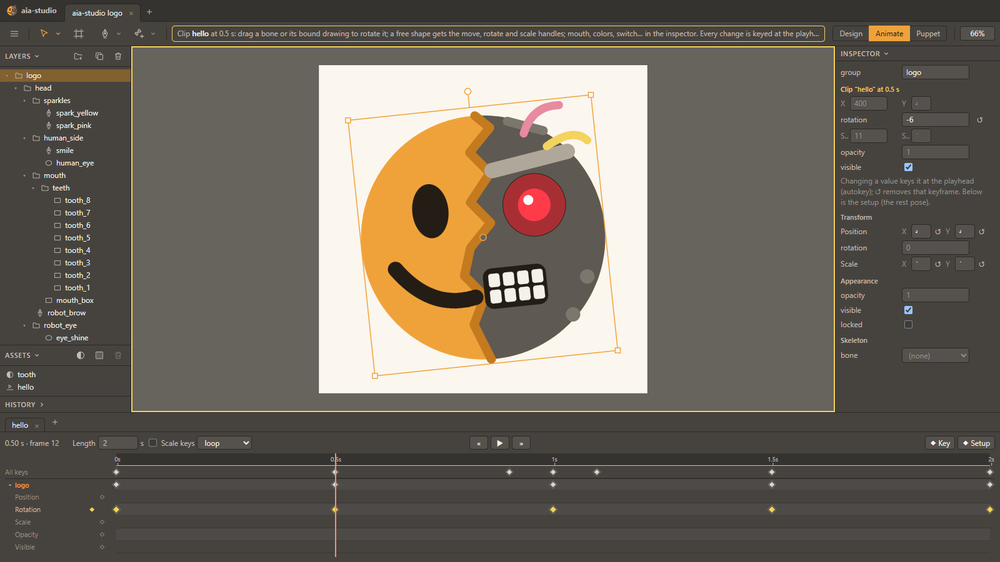

<p align="center"></p>

# aia-studio

**A drawing, animation and character-building tool made for AI first.** An AI connected over MCP can draw, rig,
pose and animate anything (characters, objects, icons, scenes) with full control: every object, property, bone, pose
and keyframe is within its reach, and it checks its own work with rendered previews.

**The human comes second, but has the last word.** Everything the AI makes opens in a visual editor where a person
can see it live and change absolutely all of it by hand. A person can also start from scratch, but the tool was
designed the other way around: so the AI has complete control, and the human can always take over.

It takes the rigging ideas of **Moho** (bone layers, smart bones, switch layers), the runtime ideas of **Rive**
(clips, a declarative runtime) and the live puppet ideas of **Adobe Character Animator** (triggers, gestures over a
base, automatic blinking and breathing).



## Why HTML, CSS, JS and SVG

That choice is the point. A character made here is not locked inside a video or a proprietary player: it is plain
web technology.

- **Easy to integrate.** It drops into any web app or component (a UI, a mascot, an assistant's face) with no plugin
  or heavy runtime.
- **Easy to use.** Anyone who knows the web can style it, script it and debug it with the browser's own tools.
- **Full control for the AI.** SVG, CSS and JS are text the AI already reads and writes fluently, so it can drive the
  character down to the last detail, both while building it and live inside the app.

## How it works

- **The document is text.** Readable JSON with meaningful names (`head`, `mouth`, `happiness`), described by a schema
  that drives validation, the editor's inspector and the AI's guide.
- **One set of operations for both.** Every action in the editor is an operation of the same API the AI uses, in
  atomic batches that can be undone. Each side undoes its own changes, and the AI reads the history to respect the
  user's hand touch-ups.
- **High-level controls.** Poses, params and drivers move many things at once, so the AI works with `happiness: 0.8`
  instead of individual vertices.
- **Three modes.** **Design** (drawing and rig), **Animate** (scene timelines for export) and **Puppet** (poses,
  params and short clips that an app or its AI triggers live).

## What you can do today

- **Draw:** vector layers as in Moho (any number of shapes over a mesh of welded points; the pen, rectangle and
  ellipse draw into the active one), groups, shared styles, linear and radial gradients, image layers (PNG, JPG,
  WebP, SVG) and SVG import. On vector layers a picked shape's points can be moved, rotated and scaled (as Moho's
  Transform Points); tangents, welding and deleting points are coming.
- **Rig:** skeletons with bones (add, manipulate, reparent), drawing bound by layer or by point, and layers that bend
  along a chain of bones.
- **Expressions:** poses, params with drivers that blend them, and switch layers for variants such as mouths.
- **Animate:** scenes with a timeline, keyframes, named easing curves and loops.
- **Puppet live:** clips that play as a base or as gestures with fades, automatic layers such as blinking and
  breathing, and a manifest that tells an app's AI which controls the character has.
- **Work alongside the AI:** both edit the same files live, with per-side undo and a shared history; layers can be
  locked so neither touches them by accident.

Not yet: exporting the character for use inside other apps (a JS runtime, video and other formats) is the next step.

## Getting started

### Desktop app (Windows)

Download `aia-studio-Setup-<version>.exe` from the
[releases](https://github.com/pederseo-dev/aia-studio/releases) and run it. It installs for your user only (no admin
rights) and needs nothing else: no Node.js, no terminal.

The installer is not signed yet, so Windows SmartScreen may say "Windows protected your PC". Click **More info →
Run anyway**. Signing (and macOS builds) will come later.

Your documents are saved in `%APPDATA%\aia-studio\documents`.

### From source

Requires Node.js 20.19+ or 22.12+.

```bash
npm install
npm run dev        # editor at http://localhost:5173
npm test           # tests
npm run typecheck  # type check (tsc over JS with JSDoc)
npm run app        # the desktop app from the repo (Electron)
npm run dist:win   # build the Windows installer into release/
```

From source, documents live in the repo's `documents/<id>/` (ignored by git). Set `AIA_DOCUMENTS` to use another
folder; the editor and the MCP server both read it.

## Connect your AI

The AI you already use drives the documents through a local MCP server over stdio (no API key, no account). It
works on the same files as the editor, so what the AI does shows up live.

**In the desktop app** you don't have to configure anything by hand: on first launch (and any time from
☰ → **Connect your AI…**) the app offers:

- **Claude Desktop:** the **Connect to Claude Desktop** button adds an `aia-studio` entry to Claude Desktop's
  settings file (keeping your other servers, with a backup next to it as `claude_desktop_config.json.aia-backup`).
  Then **fully quit Claude Desktop** (on Windows, right-click its icon in the taskbar tray → Quit) and open it again.
  The header of aia-studio shows **● Claude Desktop connected** once Claude starts it. **Disconnect** removes the
  entry. If you move or reinstall the app, the entry is updated on the next launch.
- **Claude Code:** a **Copy command** button with the `claude mcp add …` line to run once.
- **Cursor and VS Code:** one-click install links.
- **ChatGPT and claude.ai on the web** can't connect: they only reach servers on the internet, and aia-studio stays
  on your computer.

The entry runs the app's own executable as Node (`ELECTRON_RUN_AS_NODE=1`) with its bundled `mcp/server.js`, so the
MCP server is always the same version as the editor.

**From source:**

- **Claude Code:** already configured in [.mcp.json](.mcp.json); approve it when you open the folder.
- **Claude Desktop and other MCP clients:** add a server with the command `node <path-to>/aia-studio/mcp/server.js`
  (or use ☰ → Connect your AI… in `npm run dev`, which writes the same thing for you).

The AI starts with the `get_guide` tool, which explains the format and every tool.

## Project layout

| Folder | Contents |
| --- | --- |
| `schema/` | Definition of each type: the single source for validation, inspector and AI guide. |
| `src/core/` | Document, operations, skeleton, animation and live runtime (no DOM; browser and Node). |
| `src/render/` | SVG renderer. |
| `src/editor/` | The visual editor. |
| `server/` | Disk storage, history, the local API and live notices (mounted by Vite in dev and by the desktop app), AI client setup. |
| `electron/` | The desktop app's main process. |
| `mcp/` | MCP server for the AI. |
| `tests/` | Tests (`node --test`). |

## Documentation

- [docs/decision-animacion.md](docs/decision-animacion.md): the Design, Animate and Puppet modes and the clip model.
- [docs/sintesis.md](docs/sintesis.md): what aia-studio takes from Moho and Rive (research in `docs/investigacion/`).

## Credits

aia-studio is built by two, working together:

- **[pederseo-dev](https://github.com/pederseo-dev)**: the idea, the product vision and direction, design decisions
  and hands-on testing in the editor.
- **Claude** (Anthropic, through Claude Code): architecture, code, tests, audits and the AI tests of each phase,
  as a development partner. Commits it co-wrote carry `Co-Authored-By: Claude`.

The rigging, runtime and live puppet ideas come from studying Moho, Rive and Adobe Character Animator; aia-studio is
not affiliated with any of them.

## Security

aia-studio is a local tool: its server only listens on your own computer; keep the dev server off public networks. See [SECURITY.md](SECURITY.md) for details and
how to report a vulnerability privately.

## License

[MIT](LICENSE). The code is free to use, change and build into your own apps, commercial ones included. What you
draw and animate with aia-studio is yours.
